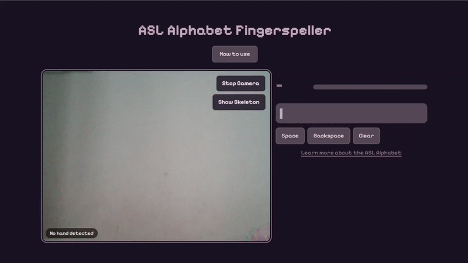
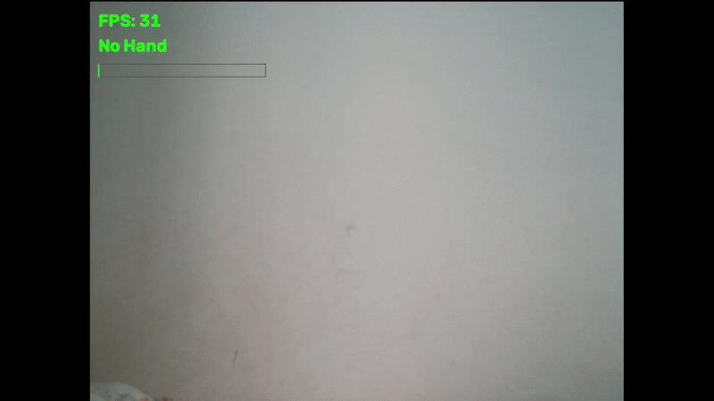

# ASL Alphabet Fingerspeller
 
A model trained on ASL alphabet datasets that types letters as you sign them (fingerspelling), running live from your webcam. Everything runs on your own device, so no video is ever uploaded. See [Model](#model) for how it works.

## Contents

- [How to Use (Web App)](#how-to-use-web-app)
- [Model](#model)
- [Running Locally](#running-locally)
  - [Web App](#web-app)
  - [Python Desktop Demo](#python-desktop-demo)
  - [Reproducing the Training Pipeline](#reproducing-the-training-pipeline)
- [Further Steps](#further-steps)
- [Credits](#credits)
 
## How to Use (Web App)
 
- A demo is available [here](https://sushiontoast.github.io/asl-project/).
- Click **Start camera**, hold up a sign from the ASL alphabet (A to Z), and keep it steady for about a second. The letter is typed into the sentence box.
- Use the **Space**, **Backspace** and **Clear** buttons (or the Space, Backspace and C keys) to edit the sentence.
- To type a double letter, drop your hand for a moment and sign the letter again.
- For best results: good lighting, a plain background, and your whole hand in view.
- To run it yourself, see [Running Locally](#running-locally).




## Model
Read more in [MODEL.md](./readme/MODEL.md)

## Running Locally
This repository has two parts: 
- `python/` contains model training and evaluation scripts, as well as a `main.py` that executes a small demo of the model. 
- `web/` contains the browser app, where the exported onnx model lies within `web/public/model/`

Ensure git is installed and clone this repository:
```bash
git clone https://github.com/SushiOnToast/asl-project.git
```

### Web App
Ensure node.js is installed.

```bash
cd web
npm install
```

Then:
```bash
npm run dev  # development server
npm run test # run tests
npm run build # create a production build
```

### Python Desktop Demo
Ensure python is installed, for this project it is recommended to install python `3.12.x`

After install python and navigating to the cloned repository:
```bash
cd python
py -3.12 -m venv .venv
```

Activate the virtual environment:
```bash
.venv/Scripts/activate # windows
source .venv/bin/activate # macOS / Linux
```
Install dependencies:
```
pip install -r requirements.txt
```

Run demo:
```bash
python main.py # or python3 for macOS / Linux
```

You will see a python demo (it is not as stylised as the web version yet):



### Reproducing the Training Pipeline
For more information on training locally, check out [TRAINING_LOCALLY.md](./readme/TRAINING_LOCALLY.md)

## Further Steps
This model and application are still in their early stages. Planned next steps:

- Train on more alphabet data from more signers.
- Improve overall letter detection and model efficiency
- Handle J and Z properly (since these letters actually require movement in their signing)
- Move on to word-level sign language classification

## Credits

This project was made possible by the following resources:

- **Training datasets:** [ASL Alphabet](https://www.kaggle.com/datasets/grassknoted/asl-alphabet) (GPL-2) and [ASL-HG](https://data.mendeley.com/datasets/j4y5w2c8w9/1) (CC BY 4.0). See [MODEL.md](./readme/MODEL.md#datasets-used) for full attribution.
- **Hand landmark detection:** [MediaPipe](https://ai.google.dev/edge/mediapipe/solutions/vision/hand_landmarker).
- **Model inference:** [ONNX Runtime](https://onnxruntime.ai/).