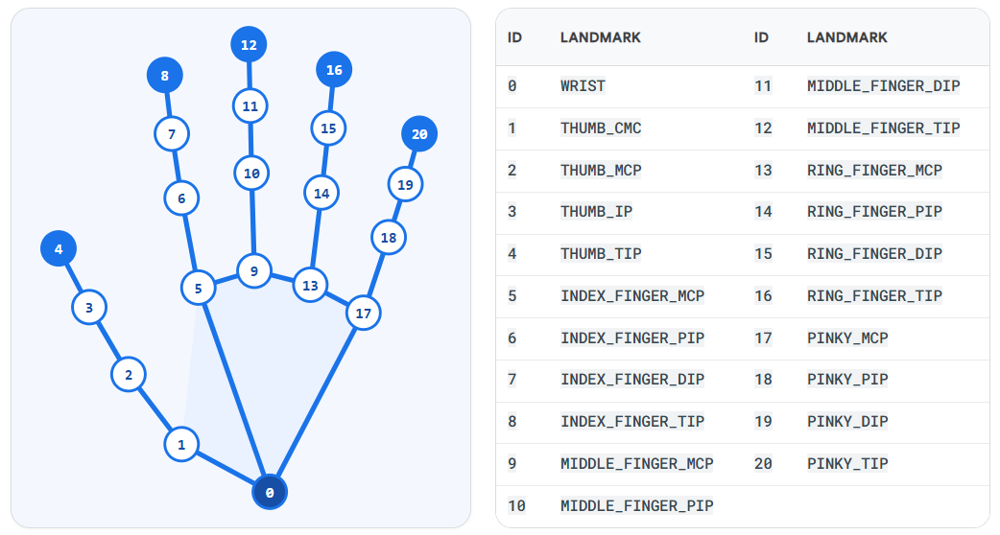

# Model

## How it works

The model does not use a CNN approach by looking at raw pixels, it instead looks at the **shape** of the hand, which is determined through the use of mediapipe's hand landmarker model.

1. MediaPipe's hand landmarker returns 21 key points (joints and fingertips per frame). This can be seen in the image below, sourced from [MediaPipe's Hand Landmarker guide](https://developers.google.com/edge/mediapipe/solutions/vision/hand_landmarker?tab=Python)



2. The points are made relative to the wrist and divided by hand size, so where your hand is in the frame and how far it is from the camera no longer matter for prediction.
3. For classification, a small multilayer perceptron (MLP) predicts one of the 26 letters from the normalised landmarks.
4. A letter is typed in the GUI once its prediction has persisted for a certain amount of frames over an established confidence threshold

The model was trained in Python with Pytorch, then exported to ONNX so that the same network can be run in browser. Both have the same preprocessing steps and the web version was also tested against the python network's outputs to ensure uniform predictions. See [TRAINING_LOCALLY.md](./TRAINING_LOCALLY.md) to reproduce the training.

## Datasets Used

The model was trained using images from the following publicly available datasets:

### 1. ASL Alphabet

- **Creator:** Akash Nagaraj (Kaggle uploader: `grassknoted`)
- **Source:** [ASL Alphabet – Kaggle](https://www.kaggle.com/datasets/grassknoted/asl-alphabet)
- **Licence:** [GNU General Public License v2.0 (GPL-2)](https://www.gnu.org/licenses/old-licenses/gpl-2.0.en.html)
- **Contents:** 87,000 images across 29 classes (A–Z, SPACE, DELETE and NOTHING).

### 2. ASL-HG: American Sign Language Hand Gesture Image Dataset

- **Contributors:** Md. Famidul Islam Pranto, Md. Rifatul Islam, Md. Ali Akbor, Nabonita Ghosh, Md. Rahatun Alam, Sudipto Chaki and Md. Masudul Islam.
- **Source:** [ASL-HG – Mendeley Data](https://data.mendeley.com/datasets/j4y5w2c8w9/1)
- **DOI:** [10.17632/j4y5w2c8w9.1](https://doi.org/10.17632/j4y5w2c8w9.1)
- **Licence:** [Creative Commons Attribution 4.0 International (CC BY 4.0)](https://creativecommons.org/licenses/by/4.0/)
- **Contents:** 36,000 images across 36 classes (A–Z and digits 0–9) collected from 10 volunteers.

The datasets were used as sources of training examples for the hand landmark-based classification model - which was trained on the **alphabet classes only**; any additional classes (e.g SPACE, DELETE, NOTHING, digits 0-9) were not used in the training pipeline. The original datasets are not included in this repository.

Please refer to the original dataset pages and their respective licences for further information about reuse and redistribution.

## Technologies Used
- **Python, PyTorch, scikit-learn, NumPy:** training and evaluation.
- **MediaPipe Hand Landmarker:** landmark detection in both the Python and web versions.
- **ONNX Runtime:** the exported model runs in the browser (ONNX Runtime Web) and in the desktop app.
- **TypeScript, Vite and Vitest:** the web app and its tests.

Python dependencies are listed in [python/requirements.txt](../python/requirements.txt)

## Model Architecture
A snippet from my python code:

```python
self.model = nn.Sequential(
    nn.Linear(63, 128),
    nn.ReLU(),
    nn.Dropout(0.2),
    nn.Linear(128, 64),
    nn.ReLU(),
    nn.Dropout(0.2),
    nn.Linear(64, n_classes),  # 26 letters
)
```

Training details:
- Classes are weighted to compensate for letters that were detected less than others
- Training data is mirrored so that the model works with either hand

